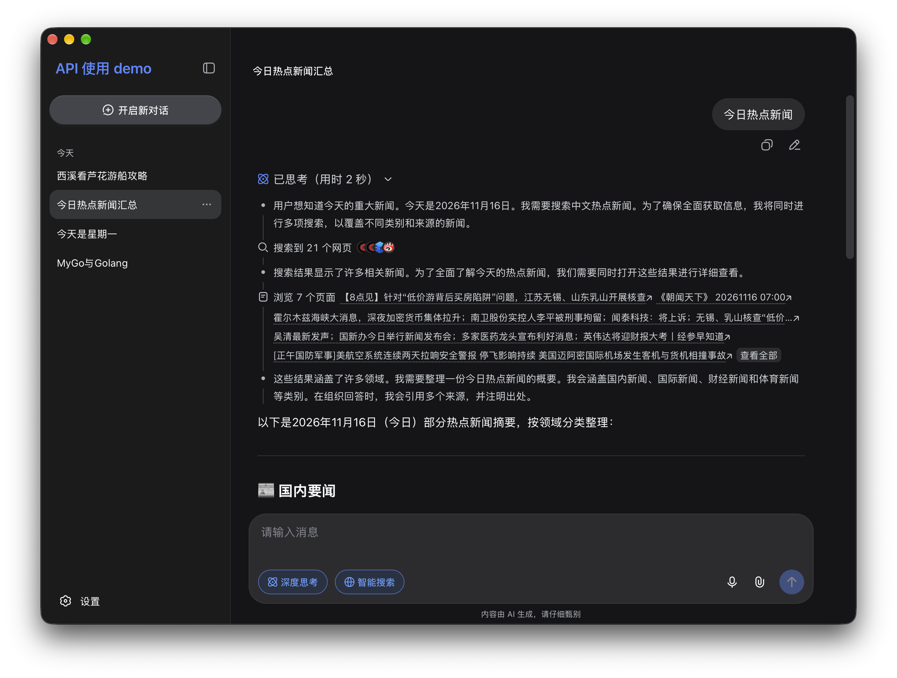
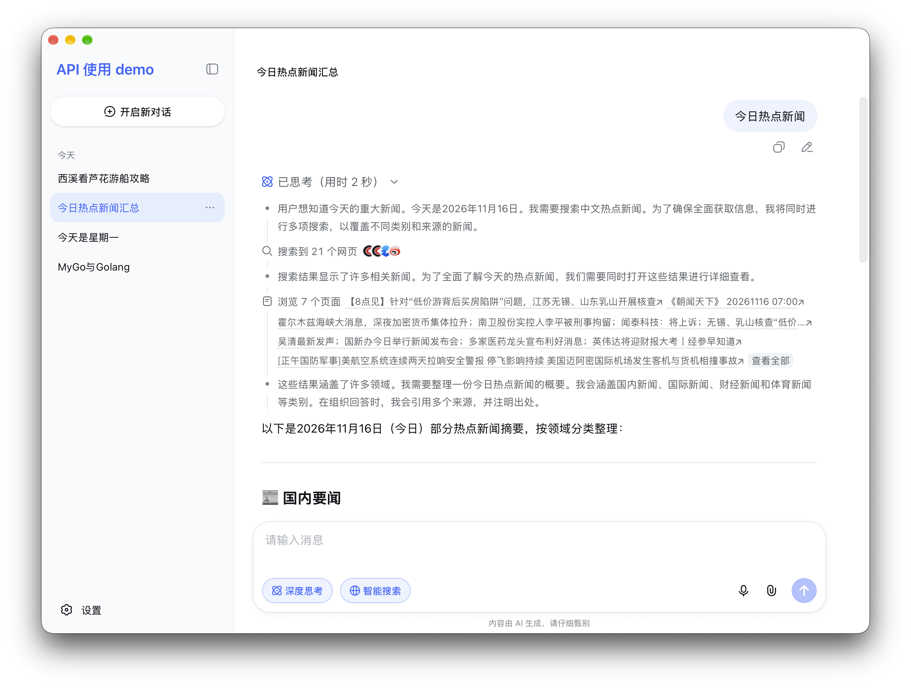
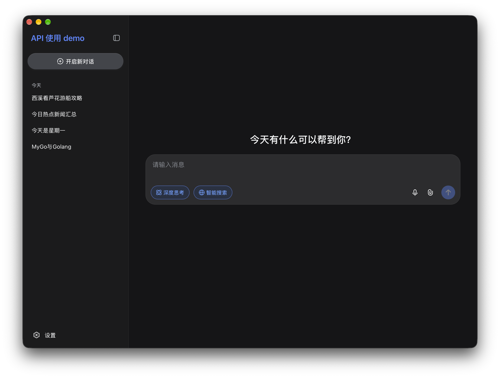
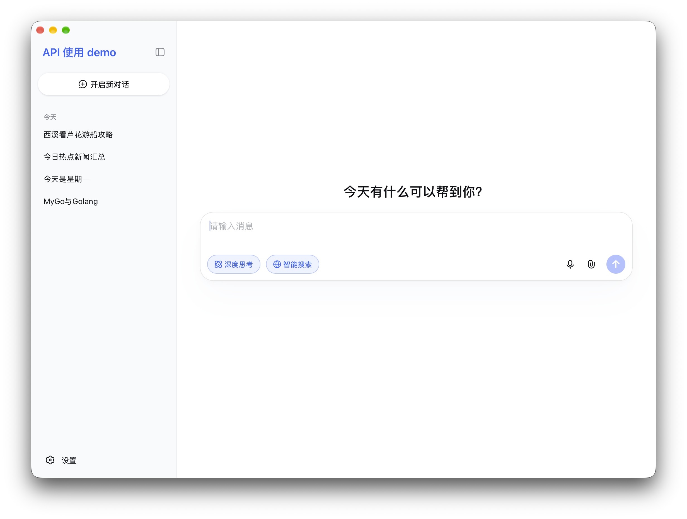
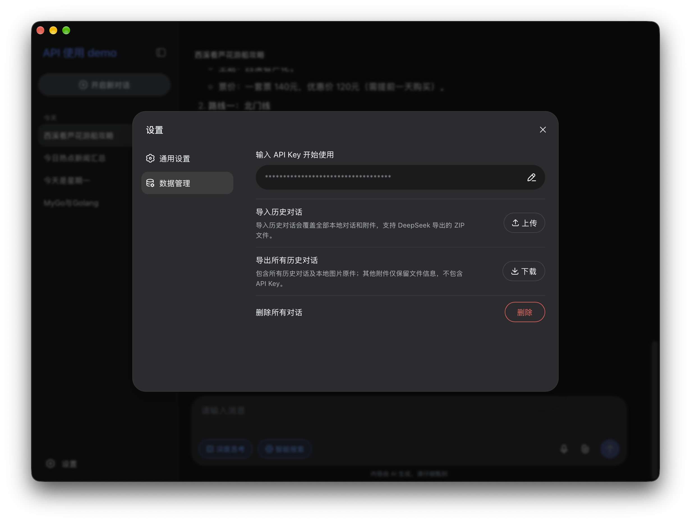
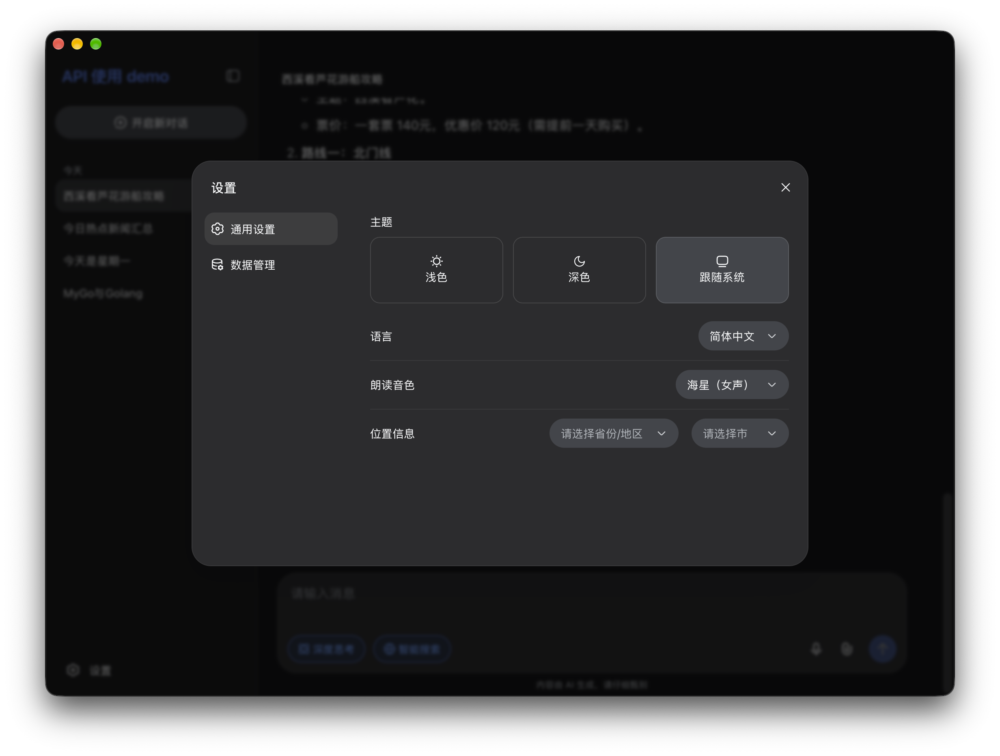

# DeepSeek Chat (MyGo 桌面端)

基于 [MyGo](https://github.com/egoist/mygo) 框架与 [chat-demo](https://github.com/deepseek-ai/chat-demo) 1:1 复刻的轻量级跨平台桌面聊天应用，支持 **macOS**、**Windows** 和 **Linux**。

无需复杂的第三方运行时，原生依托操作系统系统级 Webview（macOS WKWebView、Windows WebView2、Linux WebKitGTK）并由纯 Go（零 CGO）后端驱动。

- **超轻量体积：** macOS `.dmg` 安装包仅 **4.2 MB**，运行 bundle 约 **13.5 MB**（远小于 Electron 的 150MB+）。
- **极速冷启动：** 启动时间 < 300ms，日常内存占用约 60 ~ 80MB。
- **100% 完整复刻：** 完整继承网页端的 KaTeX 公式排版、Mermaid 矢量图表、Prism 代码高亮、流式 Markdown 平滑渲染等复杂能力。
- **原生体验增强：** 接入系统级无边框沉浸式标题栏、原生文件保存/选择对话框、窗口拖拽及 macOS 红绿灯交通灯避让。

---

## 界面预览

### 对话交互与深度思考

| 深色模式（深度思考 + 联网搜索引用） |    浅色模式（排版渲染与来源链接）    |
| :---------------------------------: | :----------------------------------: |
|  |  |

### 欢迎主界面

|               深色模式主页               |               浅色模式主页                |
| :--------------------------------------: | :---------------------------------------: |
|  |  |

### 原生设置与数据管理

| 数据管理（系统级原生文件保存与选择对话框） |    通用偏好设置（主题、语言、TTS 音色）    |
| :----------------------------------------: | :----------------------------------------: |
|     |  |

---

## 快速安装与运行

前往项目的 [Releases](https://github.com/hexbee/mygo-chat/releases) 页面下载适合您操作系统的安装包：

- **macOS：** 下载 `.dmg` 文件，双击挂载并拖拽到 `Applications` 目录即可（支持 Apple Silicon 与 Intel 双架构）。
- **Windows：** 下载 `DeepSeek Chat.exe` 直接运行或使用安装包。
- **Linux：** 提供 `.deb`、`.rpm`、`.tar.gz` 及 Arch Linux `PKGBUILD` 安装方式。

> **提示：** 首次使用时，请点击左下角 **设置** 填写您的 DeepSeek API Key。

---

## 核心功能

- **会话与交互：**
  - 支持多会话管理、自动生成会话标题、重命名与删除。
  - 支持提问二次编辑、重新生成与消息分支切换（`BranchSwitcher`）。
  - 深度思考（Reasoning 折叠块）、智能联网搜索、网页阅读与来源引用卡片（`HoverCard`）。
  - 支持生成中断与符合条件下的继续生成。
- **富文本与排版：**
  - 基于 `micromark` / `mdast` 的流式逐字增量平滑渲染。
  - KaTeX 数学公式排版（行内 `$..$` 与块级 `$$..$$`）。
  - Mermaid 流程图、时序图、状态图矢量渲染。
  - Prism.js 代码语法高亮、行号展示以及一键复制代码块。
- **多模态与语音能力：**
  - 支持图片等多类型附件上传、剪贴板图片粘贴与全局拖拽上传。
  - 系统级麦克风录音输入，内置实时音频频谱动效（`Spectrum`）。
  - 文本流式朗读（TTS / Web Audio PCM 排程播放）。
- **原生桌面能力增强：**
  - **原生文件对话框：** 历史归档的导出与导入接入系统级 `mygo.Dialog.Save` 和 `mygo.Dialog.Open`，告别网页端下载栏与基础 input 弹窗。
  - **沉浸式窗口视觉：** 采用 `TitleBarStyle: TitleBarHidden`，顶部无边框设计，全区域支持原生窗口拖拽，并完美避让 macOS 交通灯控件。
  - **双语与主题：** 支持简体中文与英文、浅色与深色主题自动切换。

---

## 数据与隐私说明

- **本地私有存储：** API Key 保存在本地 `localStorage`，会话记录及多模态图片原件存放在本地 `IndexedDB`，数据严格隔离，绝不上报给任何除 DeepSeek 官方接口以外的第三方服务器。
- **历史导入与导出：** 支持标准的 ZIP 格式数据备份。导入会在校验格式和版本后原子替换本地记录；导出将打包所有会话及本地图片原件。
- **清空对话：** 设置中提供“删除所有对话”，确认后清空所有本地会话、附件原件和草稿，保留 API Key 与配置项。

---

## 本地开发与构建

### 1. 环境准备

- **Go：** 1.27 或更高版本 (`go version`)
- **Node.js / 包管理器：** Node.js 22+ 及 `pnpm` (或 `bun 1.4+`)
- **MyGo CLI：** 全局安装或通过项目依赖运行
  ```bash
  pnpm add -g mygo-cli
  ```
  执行 `mygo doctor` 验证环境完备性。

### 2. 开发命令

```bash
# 克隆仓库并安装依赖
git clone <repo-url>
cd mygo-chat
pnpm install

# 启动桌面端开发调试（自动启动 Rspack 服务并拉起桌面窗口，支持 HMR 与 Go 增量构建）
pnpm dev

# 仅调试前端 Web 页面（端口 8090）
pnpm dev:web

# 重新生成 Go 与 TypeScript 强类型 IPC 客户端
pnpm generate
```

### 3. 项目编译与多平台打包

由于 MyGo 采用纯 Go 编写且**零 CGO 依赖**，您可以在任何操作系统上一键交叉编译全平台二进制：

```bash
# 1. 编译并打包当前宿主机安装包（macOS 下生成 .app 与 .dmg）
pnpm build

# 2. 跨平台一次性交叉编译全平台产物（macOS + Windows + Linux）
mygo build -platform darwin/arm64,darwin/amd64,windows/amd64,linux/amd64
```

产物将输出在 `build/` 目录下：

- `build/darwin-arm64/DeepSeek Chat.app` 及 `.dmg`
- `build/windows-amd64/DeepSeek Chat.exe`
- `build/linux-amd64/`（包含 `.deb`、`.rpm`、`.tar.gz` 等）

---

## 项目结构

```text
mygo-chat/
├── .agents/skills/           # MyGo 智能维护与原生模块规范 (mygo-maintenance 等)
├── .github/workflows/        # CI/CD 自动发布打包流水线 (release.yml)
├── main.go                   # Go 桌面端主入口（窗口生命周期、系统服务与 IPC 注册）
├── mygo.config.ts            # MyGo 核心配置文件（跨平台权限、窗口、前端构建参数）
├── package.json              # 前端依赖与脚本
├── rspack.config.ts          # 高性能 Rspack 构建配置（支持 lightningcss、swc）
├── tsconfig.json             # TypeScript 编译配置
├── shot/                     # 桌面端界面实际运行截图
├── src/
│   ├── app/                  # 应用顶层布局、视口与深浅色主题
│   ├── components/           # 界面组件（消息列表、输入框、设置框、侧边栏等）
│   ├── i18n/                 # 国际化文案（中文 / 英文）
│   ├── mygo.ts               # mygo generate 自动生成的类型安全 IPC 客户端
│   ├── services/
│   │   ├── api/              # DeepSeek API、Anthropic 兼容协议、SSE 流解析
│   │   ├── chat/             # 会话状态机、分支切换、IndexedDB 存储与 ZIP 归档
│   │   ├── desktop/          # Go 桌面端原生服务适配（文件对话框等）
│   │   ├── markdown/         # KaTeX, Mermaid, Prism 高亮与 AST 渲染
│   │   └── speech/           # 麦克风录音与流式 TTS 朗读
│   ├── utils/                # 剪贴板、ID、日期格式化等基础工具
│   └── main.tsx              # 前端入口
└── build/                    # 桌面端安装包产物目录
```

---

## 质量与代码规范

| 命令          | 说明                                 |
| :------------ | :----------------------------------- |
| `pnpm type`   | TypeScript 全量严格类型检查          |
| `pnpm lint`   | 使用 Oxlint 执行代码检查             |
| `pnpm format` | 使用 Oxfmt 统一代码格式              |
| `mygo doctor` | 检查本地 Go、Webview、打包工具链状态 |

---

## 许可证

本项目遵循 [MIT License](LICENSE)。构建产物中包含的第三方开源组件均遵循各自的许可协议。
