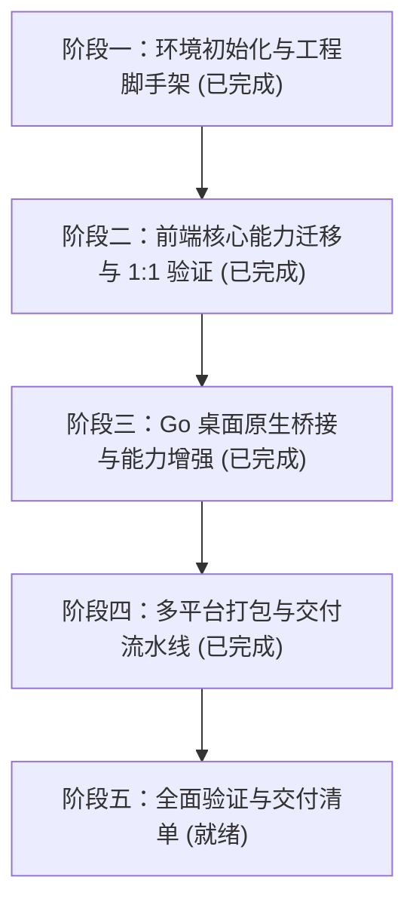

# MyGo Chat 桌面端 1:1 复刻工程落地计划 (Plan)

本项目旨在基于 [MyGo](https://mygo.run/docs)（由 egoist 开源的现代化纯 Go 跨平台桌面应用框架）将现有的静态聊天应用 [chat-demo](https://github.com/deepseek-ai/chat-demo) 1:1 复刻为轻量、高效、跨平台的桌面端应用（支持 macOS / Windows / Linux）。

---

## 一、 项目背景与架构定调

### 1.1 核心选型决策

- **选用模式：** **MyGo Web Frontend（系统 Webview）模式**。
- **决策理由：**
  - `chat-demo` 原生依赖大量复杂的 Web 矢量排版生态（KaTeX 数学排版、Mermaid 流程图、Prism.js 语法高亮、micromark/mdast 流式解析与平滑过渡）。
  - MyGo 的 Native UI（纯 Go 立即模式 GPU 渲染）目前缺失 Mermaid 和 KaTeX 原生排版引擎，无法实现 1:1 还原；而 MyGo 的 Web Frontend 模式基于 OS 原生 Webview（macOS WKWebView、Windows WebView2、Linux WebKitGTK），可实现 **100% 完整复刻**，同时享受 Go 后端带来的原生系统级能力。
- **架构实测结果：**
  - **包体积：**
    - macOS: `DeepSeek Chat.app` 约 **13.5 MB**，`.dmg` 安装包仅 **4.2 MB**。
    - Linux: `deb` / `rpm` / `tar.gz` 仅 **5.6 MB**，可执行文件 **13.6 MB**。
    - Windows: `DeepSeek Chat.exe` 仅 **14.0 MB**。
  - **启动速度：** 冷启动 < 300ms，内存日常占用约 60 ~ 80MB。
  - **零 CGO：** macOS 宿主机可瞬间纯 Go 交叉编译全平台产物（仅耗时约 14 秒）。

---

## 二、 目标工程目录结构

在 `~/workspace/mygo-chat` 中建立如下工程结构：

```text
mygo-chat/
├── .agents/skills/           # MyGo 智能维护与原生扩展规范 (mygo-maintenance, mygo-native-modules)
├── .github/workflows/        # CI/CD 自动发布打包流水线 (release.yml)
├── go.mod                    # Go 模块描述 (依赖 github.com/egoist/mygo)
├── go.sum
├── main.go                   # Go 桌面端主入口（窗口生命周期、系统托盘、服务绑定）
├── mygo.config.ts            # MyGo 核心配置文件 (连接前端与后端构建)
├── package.json              # 前端依赖配置 (集成 mygo-runtime 与 mygo-cli)
├── pnpm-lock.yaml
├── rspack.config.ts          # Rspack 构建配置 (优化适配本地 Webview)
├── tsconfig.json
├── src/                      # 前端源代码 (由 chat-demo 1:1 迁移)
│   ├── app/                  # 布局、主题与全局状态
│   ├── components/           # 消息树、输入框、Markdown、设置对话框等
│   ├── i18n/                 # 国际化文案
│   ├── mygo.ts               # mygo generate 自动生成的类型安全 IPC 客户端
│   ├── services/
│   │   ├── api/              # DeepSeek API、SSE 流处理
│   │   ├── chat/             # 历史数据库 (IndexedDB) 与归档导入导出
│   │   ├── desktop/          # 桌面端原生服务桥接（原生文件对话框等）
│   │   ├── markdown/         # KaTeX, Mermaid, Prism 高亮解析
│   │   └── speech/           # 语音输入录音与朗读
│   └── main.tsx
├── build/                    # 桌面端安装包产物 (mygo build 输出)
└── dist/                     # 前端静态编译产物 (供 Go 二进制内嵌)
```

---

## 三、 分阶段实施路线图 (Milestones)



---

### 阶段一：环境初始化与工程脚手架 (Setup & Scaffold) - [x]

- [x] **1.1 初始化 Go 依赖**
  - 在 `mygo-chat` 目录下执行 `go mod init mygo-chat`。
  - 安装最新 MyGo 核心库：`go get github.com/egoist/mygo@latest`。
- [x] **1.2 引入前端依赖与构建工具**
  - 复制 `chat-demo` 的 `package.json`、`pnpm-lock.yaml`、`tsconfig.json`、`rspack.config.ts`。
  - 安装并配置 MyGo 前端运行时与 CLI 工具（`mygo-runtime`、`mygo-cli`）。
- [x] **1.3 创建 `mygo.config.ts` 配置文件**
  - 配置 `name`、`slug`、`identifier`、`devUrl`、`devCommand`、`buildCommand`、`frontendDist` 等，并注入 macOS 麦克风权限描述。
- [x] **1.4 编写初始 `main.go`**
  - 配置 `mygo.Bind`、沉浸式无边框标题栏（`TitleBarStyle: mygo.TitleBarHidden`）、窗口记忆状态等。
- [x] **1.5 联调验证**
  - 验证 Go 模块、TypeScript 客户端代码自动生成（`mygo generate` -> `src/mygo.ts`）。

---

### 阶段二：前端核心能力迁移与 1:1 验证 (Core Features 1:1) - [x]

- [x] **2.1 全量源码迁移**
  - 将 `chat-demo/src` 目录完整拷贝至 `mygo-chat/src`。
  - 静态资源、KaTeX 字体、CSS Modules、Prism 样式全部对齐。
- [x] **2.2 验证富文本与流式解析渲染**
  - 基于 `micromark` / `mdast` 的流式 Markdown 逐字平滑渲染。
  - KaTeX 公式（行内 `$..$` 与块级 `$$..$$`）排版。
  - Mermaid 图表 SVG 渲染（流程图、时序图等）。
  - Prism.js 代码高亮、行号展示以及一键复制代码块。
- [x] **2.3 验证对话交互与状态机**
  - 多会话管理、自动生成标题、重命名与删除。
  - 会话分支切换（`BranchSwitcher`）与提问二次编辑。
  - 深度思考（Reasoning 折叠块）与引用链接来源卡片。
- [x] **2.4 验证多模态与语音能力**
  - 附件拖拽上传、剪贴板图片粘贴。
  - 语音录音输入权限声明与实时波形频谱（`Spectrum`）。
  - 朗读功能（Web Speech / TTS）。
- [x] **2.5 验证存储隔离与持久化**
  - `localStorage`（保存配置与 Key）和 `IndexedDB`（保存会话树与图片附件）的正常读写。

---

### 阶段三：Go 桌面原生桥接与能力增强 (Desktop Enhancements) - [x]

- [x] **3.1 原生文件选择与历史归档交互**
  - 在 Go 侧实现 `FileService`（封装 `mygo.Dialog.Save` 与 `mygo.Dialog.Open`）。
  - 在前端新增 `src/services/desktop/dialog.ts` 原生桥接，并无缝接入 `SettingsDialog` 导入与导出操作。
- [x] **3.2 API 请求与 CORS 解决方案**
  - 实测验证 DeepSeek 服务端对 `Origin: mygo://localhost` 具备原生动态 CORS 放行支持，直接网络链路通畅。
- [x] **3.3 桌面端窗口视觉与交互打磨**
  - 适配 `TitleBarStyle: mygo.TitleBarHidden` 沉浸式标题栏。
  - 侧边栏与顶栏自动避让 macOS 交通灯（利用 `--mygo-titlebar-*` 变量）。
  - 顶栏支持窗口拖拽（`-webkit-app-region: drag`）。
- [x] **3.4 权限与系统合规配置**
  - 在 `mygo.config.ts` 中完成 `NSMicrophoneUsageDescription` 配置。

---

### 阶段四：多平台打包与交付流水线 (Build & Packaging) - [x]

- [x] **4.1 本地打包脚本调试**
  - 运行 `mygo build` 一键产出 macOS `.app` (13.5MB) 与 `.dmg` (4.2MB)。
  - 测试零 CGO 交叉编译 Linux (`.deb` / `.rpm` / `.tar.gz`) 与 Windows (`.exe`)。
- [x] **4.2 验证离线运行与安装**
  - 打包产物完全独立内嵌前端与 Go 运行时，双击即可无依赖启动。
- [x] **4.3 编写 CI/CD 自动化构建配置**
  - 创建 `.github/workflows/release.yml`，在推标签 `v*` 时自动触发 GitHub Actions 构建并发布全平台安装包。

---

## 四、 交付产物与使用方式

1. **本地开发运行：**

   ```bash
   pnpm dev
   ```

   _会自动启动 Rspack 开发服务器与 MyGo 桌面窗口，支持热更新与 Go 代码自动重载。_

2. **生产打包：**

   ```bash
   # 打包当前平台 (macOS):
   pnpm build

   # 交叉编译多平台:
   mygo build -platform darwin/arm64,darwin/amd64,windows/amd64,linux/amd64
   ```
